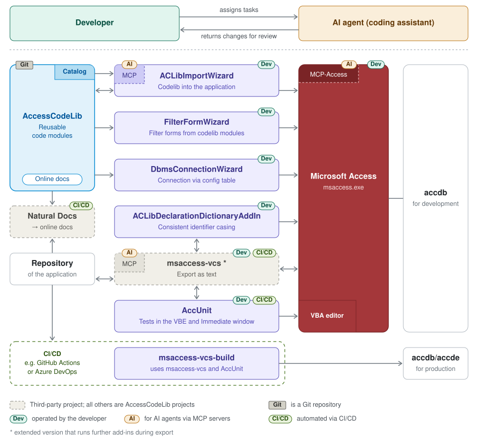

## AccessCodeLib

Open-source tools for developing Microsoft Access applications with VBA:
reusable code modules, add-ins that bring them into your application,
unit testing, version control and CI/CD builds – usable by developers
and by AI coding agents via MCP servers.

### How the tools work together

### Tools

| Repository | Purpose |
|---|---|
| [AccessCodeLib](https://github.com/AccessCodeLib/AccessCodeLib) | Reusable VBA code modules for Access applications ([online docs](https://accesscodelib.github.io/AccessCodeLib/), [catalog](https://github.com/AccessCodeLib/AccessCodeLib/tree/master/_codelib/catalog)) |
| [ACLibImportWizard](https://github.com/AccessCodeLib/ACLibImportWizard) | Add-in that imports codelib modules into an application |
| [ACLibImportWizard-MCP](https://github.com/AccessCodeLib/ACLibImportWizard-MCP) | MCP server that lets AI agents use the import wizard |
| [FilterFormWizard](https://github.com/AccessCodeLib/FilterFormWizard) | Add-in that creates filter forms from codelib modules |
| [DbmsConnectionWizard](https://github.com/AccessCodeLib/DbmsConnectionWizard) | Add-in that configures DBMS connections via a config table |
| [ACLibDeclarationDictionaryAddIn](https://github.com/AccessCodeLib/ACLibDeclarationDictionaryAddIn) | Lists all VBA declarations and ensures consistent identifier casing |
| [AccUnit](https://github.com/AccessCodeLib/AccUnit) | Unit tests for VBA/Access code, run in the VBE and Immediate window |
| [msaccess-vcs-build](https://github.com/AccessCodeLib/msaccess-vcs-build) | CI/CD: builds accdb/accde from msaccess-vcs source exports |

### Third-party projects shown in the diagram

- [msaccess-vcs-addin](https://github.com/joyfullservice/msaccess-vcs-addin) and
  [msaccess-vcs-mcp](https://github.com/joyfullservice/msaccess-vcs-mcp) by joyfullservice –
  the extended version that runs further add-ins during export is maintained in
  [this fork](https://github.com/josef-poetzl/msaccess-vcs-addin)
- [MCP-Access](https://github.com/unmateria/MCP-Access) by unmateria
- [Natural Docs](https://github.com/NaturalDocs/NaturalDocs)

Microsoft Access is a trademark of the Microsoft Corporation.
